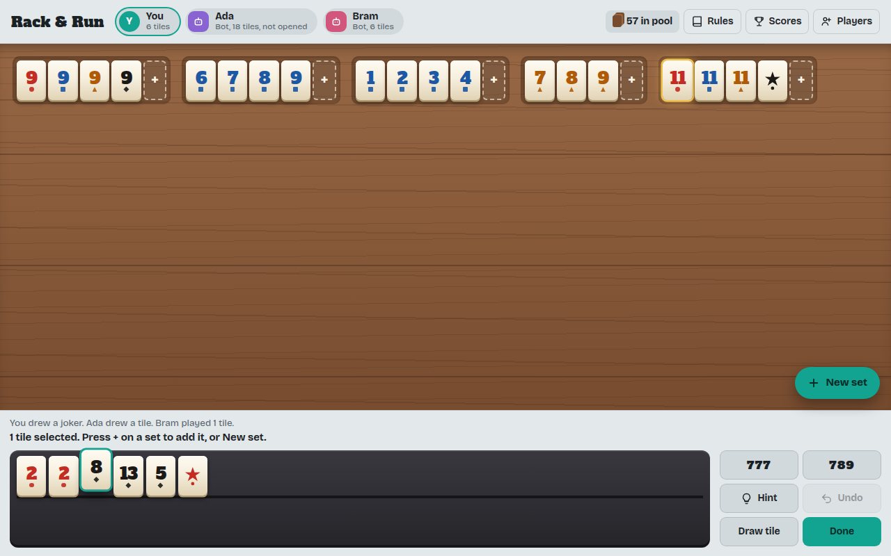

# Rack & Run

A tile rummy game played by the classic Rummikub rules, for 2 to 4 players in any mix of people and bots. It runs as an Android app and as a website, so phones, tablets and computers can all play together.



## What's in it

- The full rules: 106 tiles, runs and groups, a 30-point opening, rearranging the table, jokers, and official scoring with a joker costing 30.
- Bots at three levels. Easy plays sets from its own rack, Normal also rearranges part of the table, and Hard finds the play that lays down the most tiles.
- One device: pass a phone or tablet around. Each player's tiles stay hidden until they tap to reveal them.
- Separate devices: each person plays on their own phone, tablet or computer. Everyone watches the current player's table live as they rearrange it, while racks stay private. This needs a free Firebase project; see [Turn on online play](#turn-on-online-play).
- Hints (which can be switched off when setting up a game), a turn timer, rack sorting, drag and drop or tap to select, scores across games, and light and dark themes.
- No network needed for one-device games. The fonts and everything else ship inside the app.

## Put it on GitHub

1. Create a new, empty repository on GitHub (no README or license; this project has both).
2. Upload this folder. The easiest ways:
   - **GitHub Desktop:** File > Add local repository, pick this folder, publish it to the repository you created.
   - **Command line**, from inside this folder:
     ```
     git init -b main
     git add .
     git commit -m "Rack & Run"
     git remote add origin https://github.com/YOUR-NAME/rack-and-run.git
     git push -u origin main
     ```
   Dragging files into the GitHub website can skip the hidden `.github` folder, which holds the build setup, so use one of the two options above.

## Get the Android app (APK)

Every push to `main` builds the app automatically.

1. On GitHub, open the **Actions** tab and click the latest **Android APK** run. It takes about five minutes.
2. Under **Artifacts**, download `rack-and-run-apk`. It's a zip; the APK is inside.
3. Copy the APK to the phone (or download it there) and open it. Android asks you to allow installs from that source the first time.

For a permanent download link, publish a release: push a tag such as `git tag v1.0.0 && git push origin v1.0.0`. The APK is then attached to that release on the **Releases** page, ready to share with the other players.

To update, just install the new APK over the old one; there's no need to uninstall, and saved games and scores stay. Every build is signed with the project's key from `keystore/` (the build stops with an error if it ever isn't) and gets a higher version number than the one before. You can see which version a phone has under Settings > Apps > Rack & Run, for example `1.0.0.12`, where the last number is the build number on GitHub.

## Turn on online play

Online play needs somewhere to keep the shared game. This project uses Firebase, which is free at this size. It takes about ten minutes, once.

1. Go to [console.firebase.google.com](https://console.firebase.google.com), choose **Create a project**, and give it any name. Google Analytics isn't needed.
2. **Build > Authentication > Get started > Sign-in method:** enable **Anonymous**. Each device then signs in on its own, with no accounts or passwords for the players.
3. **Build > Firestore Database > Create database:** pick a location near you and start in **production mode**.
4. In Firestore, open the **Rules** tab, replace everything with the contents of [`firestore.rules`](firestore.rules), and click **Publish**.
5. Click the gear icon > **Project settings** > **Your apps** > the web icon (`</>`). Register an app called "Rack & Run". Firebase shows a `firebaseConfig` block.
6. Copy those values into [`www/firebase-config.js`](www/firebase-config.js), then commit and push. The next build has online play.
7. If you use the website version, go to **Authentication > Settings > Authorized domains** and add `YOUR-NAME.github.io`.

To play: everyone opens the app, taps **Players**, then **Separate devices**. One person enters their name, sets the other seats to Person or Bot, and taps **Create table**. The others enter their names and tap **Join**. The host taps **Start game**.

Things to know:

- **Identity:** each device is its own player, so come back to a game on the same phone or computer you joined from.
- **Visibility:** anyone with your copy of the app can see the list of open tables.
- **Hidden tiles:** each person sees only their own tiles, but the game data isn't encrypted, so someone determined could read other racks through developer tools.
- **Leaving:** use Players > Leave table, or the Leave button next to a table in the list. Your seat goes to a bot so the others can carry on, and when the last person leaves, the table is deleted.
- **Cleanup:** whenever someone opens the table list, tables nobody can return to are removed automatically: everyone has left, or a waiting room has sat idle for 12 hours, or a game hasn't been touched in 14 days.

## Play in a browser (iPhone, iPad, PC)

The APK is Android-only. The same game also runs as a website on GitHub Pages:

1. In the repository, open **Settings > Pages** and set **Source** to **GitHub Actions**.
2. The **Website** workflow publishes the game at `https://YOUR-NAME.github.io/REPOSITORY-NAME/`. Run it again from the Actions tab if it ran before Pages was turned on.
3. On an iPhone or iPad, open that link in Safari, tap Share > **Add to Home Screen**, and it opens like an app.

Website players and Android app players can sit at the same online table.

## Work on it

You need [Node.js 22](https://nodejs.org) or newer.

```
npm install
npm run serve     # play at http://localhost:8080
npm test          # simulated games check every move against the rules, plus online-adapter tests
```

To build the APK on your own computer instead of GitHub, install [Android Studio](https://developer.android.com/studio), then:

```
npm run android:add      # once: creates the android/ folder, signed with the project key
npm run android:assets   # app icon and splash screens from assets/
npm run android:sync     # after every change in www/
npm run android:open     # opens Android Studio; press Run, or Build > Build APK
```

### Project layout

| Path | What it is |
| --- | --- |
| `www/index.html` | The whole game: rules, bots, interface |
| `www/backend.js` | Connects online play to Firebase |
| `www/firebase-config.js` | Your Firebase settings (fill these in) |
| `www/vendor/firebase.js` | Bundled Firebase SDK (`npm run build:vendor` rebuilds it) |
| `assets/` | Source images for the app icon and splash screens |
| `keystore/debug.keystore` | Signing key, so updates install over old versions |
| `tools/configure-android.mjs` | Applies that key and a new version number to each Android build |
| `test/` | Rule simulation and adapter tests |
| `.github/workflows/` | Builds the APK and publishes the website |

## Notes

- **Signing:** `keystore/debug.keystore` is a development key (password `android`). It's fine for sharing the app with family. Keep this file: an APK signed with any other key can't install over the app already on your phones. Anyone with this repository could sign an app that updates yours, so before publishing on Google Play, create a private release key and keep it out of the repository.
- **The name:** Rummikub is a registered trademark of M&M Ventures (2014) Ltd. Rack & Run is an independent project that follows the published rules and isn't affiliated with or endorsed by them. Check the trademark question before distributing it publicly, for example on Google Play.
- **Licenses:** the code is MIT-licensed (see `LICENSE`). The fonts, Alfa Slab One and Bricolage Grotesque, are under the SIL Open Font License; their license files are in `www/fonts/`.
